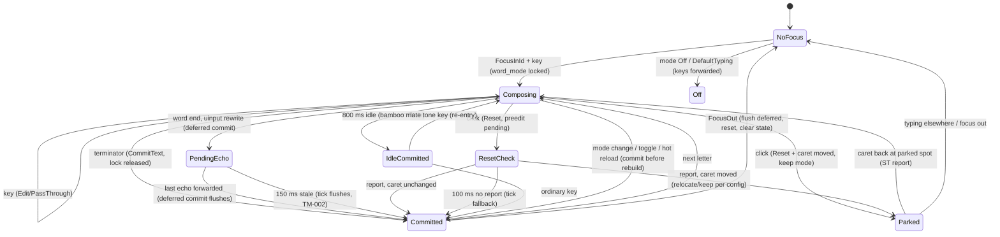

# Typing-modes audit — ibus-mangrs

Audit of the input-mode machinery per the owner's spec (`fix/typing-modes`
branch). Read-only analysis plus targeted fixes; every fix has a red-to-green
test and its own commit. All commands were actually run; everything not run
on a real desktop is labeled and left for the manual matrix.

## 1. Executive summary

Before: 197 tests green on the audit baseline. The real-mode survey confirmed
eight display modes in code (the spec's reference list is ibus-bamboo's, which
the Rust engine deliberately does not mirror one-to-one). Building the
FakeClient matrix exposed three proven defects on top of the ones already
fixed on `dev` earlier in this session; all three are fixed here with tests:

- TM-001: a delete-swallowing client that is not on the Chrome/Electron name
  list corrupted every mark key in NonPreedit/Surrounding and the engine
  could never detect it ("aa" became "aâ" forever). Fixed by a report-proof
  of rewrite-delete delivery and a preedit fallback for following words.
- TM-002: a lost injected-Backspace echo held the deferred word-end commit
  until the user typed the next key; if the user stopped typing, the erased
  word never appeared. Fixed by running the stale check in the main loop.
- TM-003: a mid-session uinput device failure on such a client duplicated
  the word anyway (protocol fallback + paired commit both land nowhere or
  only the commit lands). Fixed by keeping the raw text and notifying the
  engine.

Top three remaining risks: (1) everything in the manual matrix below is
unverified on real desktops; (2) `verify_surrounding` deliberately ignores
drift whose `tail` sits more than 2 chars from the caret (Chrome find-bar
protection) — real drift there is never repaired, by design; (3) the
`relay_context()` treatment of client-`None` contexts is conservative for
delete safety but also applies the relay-only navigation-key swallow to
X11 clients (Sublime), which costs one swallowed arrow key per preedit
commit — needs a live measurement before changing.

After: 207 tests green, `clippy --all-targets` clean, `cargo fmt --check`
clean, `cargo build --release --features gui` green.

## 2. Scope and deviations from the spec

- Branched from `dev`, not `master`: `dev` carries nine commits of
  typing-mode fixes already reviewed with the owner earlier in this session
  (VIQR/Microsoft mark keys, per-path delete-transport gates, keypad keysyms,
  Backspace honoring the word-mode lock, mutex-poison recovery, key-path I/O).
  The audit's TM commits sit on top.
- The spec's context says "133 tests, 480 golden" — the code has 207 tests
  and 678 golden cases at audit end. Code wins; documented here.
- The spec says shift+left / XTest / forward-as-commit / bypass-us "do not
  exist". Code check: **Shift+Left exists** (`src/uinput.rs::select_left`,
  `Action::SelectLeft`, the Select display mode) — recorded as an abnormal
  finding against the spec's claim. XTest does not exist (the engine uses
  `/dev/uinput` for the same purpose); "forward as commit" does not exist;
  there is no `us` exclusion mode (the functional equivalent is
  `[[app_rules]]`).

## 3. Real mode map (verified in code, not from docs)

Resolution chain: `Engine::effective_mode` (`src/engine.rs`) — hard fallback
(no `IBUS_CAP_PREEDIT_TEXT` -> NonPreedit; uinput modes fall back to Preedit
on mutter-relayed contexts, without `/dev/uinput`, or — for Select — without
an ST report) -> `[[app_rules]]` substring match on the prgname -> built-in
heuristics (inline suggestions -> Preedit; name-listed delete-swallowers ->
Preedit; proven swallowed rewrite deletes without uinput -> Preedit). The
`word_mode` lock freezes the resolved mode for the whole word.

| Mode (config key) | Family | Delete transport | Word delivery | Client capability needed | X11/Wayland dependency | Handled in |
|---|---|---|---|---|---|---|
| Preedit (`preedit`, default) | preedit | none needed | one `CommitText` at terminator | `IBUS_CAP_PREEDIT_TEXT` else falls back | none (works relayed) | `engine.rs::process_char` / `on_edit` Preedit arm |
| NonPreedit (`nonpreedit`) | non-preedit | protocol `DeleteSurroundingText`, or uinput Backspace, or raw-forward if none | per-key `CommitText` + tail rewrite | ST report or uinput for marks | uinput needs `/dev/uinput` | `engine.rs::on_edit` Unicode/legacy arms |
| Surrounding (`surrounding`) | non-preedit | same as NonPreedit + verify/repair | same | ST report (repairs skipped on relays) | same | `engine.rs::verify_surrounding`, `sync_from_surrounding` |
| Smooth (`smooth`) | non-preedit (real keys) | paced uinput Backspaces | raw keys forwarded; word-end rewrite via `InjectBackspaces` + Commit/clipboard | writable `/dev/uinput`; falls back to Preedit on relays | X11 sessions only in practice | `engine.rs::process_char_smooth`, `on_finish_smooth`, `server.rs::emit_with` |
| Super Smooth (`supersmooth`) | non-preedit (real keys) | same, no pre-rewrite check | same | same | same | same |
| Select (`select`) | non-preedit (real keys) | Shift+Left selection + Delete | same, selection erase | ST report + `/dev/uinput` | X11 | `engine.rs::smooth_rewrite` Select arm |
| OFF (`off`) | bypass | n/a | raw forward; macros when `macro_in_off_mode` | none | none | `engine.rs::process_char_off` |
| Default Typing (`defaulttyping`) | bypass | n/a | every key forwarded, nothing remembered | none | none | `engine.rs::process_char` early return |

### Comparison with the ibus-bamboo Go reference (`analysis/ibus-bamboo/config/flags.go::ImLookupTable`)

| ibus-bamboo Go | Rust | Note |
|---|---|---|
| PreeditIM | Preedit | same semantics |
| SurroundingTextIM | Surrounding | same semantics |
| BackspaceForwardingIM (ForwardKeyEvent I) | no direct equivalent; closest is the uinput Backspace transport used by NonPreedit repair and the Smooth modes | different mechanism, same goal |
| ShiftLeftForwardingIM (ForwardKeyEvent II) | **Select** (`Action::SelectLeft`) | exists in Rust — abnormal finding vs the spec |
| ForwardAsCommitIM | **missing** | no Rust equivalent; not built |
| XTestFakeKeyEventIM | **missing as XTest**; `/dev/uinput` covers the same need | different kernel API |
| UsIM (exclusion list) | `[[app_rules]]` | different shape (per-app mode instead of exclusion) |
| — (none) | NonPreedit, OFF, Default Typing, Smooth, Super Smooth | Rust-only modes |

## 4. Action fingerprints (audit cases, captured from the real engine)

Pinned as a regression test (`golden.rs::fingerprint`). Ideal client,
Telex, fresh ST reports.

Case (a) `t i e e n g s` + Space -> "tiếng ":

- NonPreedit and Surrounding: `Commit(t)`, `Commit(i)`, `Commit(e)`,
  `DeleteBefore(1)+Commit(ê)`, `Commit(n)`, `Commit(g)`,
  `DeleteBefore(3)+Commit(ếng)`, `Forward`.
- Preedit: `UpdatePreedit` per key (`t` .. `tiếng`), then
  `HidePreedit, Commit(tiếng), Forward`.

Case (b) `a a s` + Space -> "ấ ":

- NonPreedit and Surrounding: `Commit(a)`, `DeleteBefore(1)+Commit(â)`,
  `DeleteBefore(1)+Commit(ấ)`, `Forward`.
- Preedit: `UpdatePreedit(a)`, `UpdatePreedit(â)`, `UpdatePreedit(ấ)`,
  `HidePreedit, Commit(ấ), Forward`.

## 5. Implicit client assumptions per mode/transport

- Protocol delete: the client applies `DeleteSurroundingText(iu)` exactly
  once, at the reported caret; the report that follows is fresh. Proven false
  for Chrome/Electron (name heuristic) and now detectable in general
  (TM-001 report proof).
- uinput Backspace: echoes of injected keys come back through
  ProcessKeyEvent in order; lost echoes age out after `Engine::ECHO_STALE`
  (150 ms). False for apps that receive injected keys without routing them
  through IBus — the stale flush covers it (TM-002).
- Preedit: the client renders the preedit string and applies `CommitText`
  at the current caret; on mutter-relayed contexts a forwarded key can
  outrun the commit (hence the first-navigation-key swallow).
- Surrounding verify: reports are in Unicode code points (not bytes), the
  caret is the prefix length, and drift farther than 2 chars from the
  caret is stale/unrelated (intentional, Chrome find bar).
- All modes: one client at a time; `fake` interleaves but owns nothing;
  focus changes invalidate all buffer beliefs (`clear_buffer_state`).

## 6. Engine state machine (Mermaid)



Not drawn as states but tracked in parallel: `awaiting_delete_proof`
(one rewrite delete), `repair_delete`/`delete_dropped`, `suggestions`,
`url_word`, nav-echo queue (`pending_nav`).

## 7. Findings

### TM-001: rewrite deletes swallowed by unlisted clients are undetectable and unrepaired
- Severity: High.
- Confidence: [ĐÃ TÁI HIỆN] (`golden.rs::matrix::drop_delete_clients_still_get_the_right_text`, red before the fix).
- Modes/transport/clients: NonPreedit, Surrounding; protocol delete; any
  delete-swallowing client NOT on the Chrome/Electron name list.
- Symptom: "aa" left "aâ" on screen and every following word corrupted the
  same way; the engine classified each report as healthy because the text
  ends with the believed tail.
- Root cause: regular rewrite deletes had no delivery feedback; the healthy
  classification (`ends_with`) cannot see a swallowed delete of the word's
  own prefix.
- Fix: commit `7a380b5`. Every rewrite `DeleteBefore` paired with an insert
  arms a proof (`awaiting_delete_proof`, expected prefix length for
  delivered vs swallowed); the next ST report settles it; a proven swallow
  sets `delete_dropped`, and without uinput `effective_mode` moves the
  following words to Preedit. Pure deletions are not armed (stale reports
  are indistinguishable there). Repair pipeline got one step shorter for
  proven swallows (straight to `RewriteByBackspace`); the two repair
  regression tests now pin the new intermediate contract, final texts
  unchanged.
- Invariants checked: 1, 2, 4, 5 (no new protocol deletes; the preedit
  fallback removes the need entirely).
- Remaining risk: the first corrupted word stays corrupted (nothing can
  undo what the app never deleted) — documented, not fixable engine-side.

### TM-002: lost echo held the deferred commit until the next keystroke
- Severity: High.
- Confidence: [ĐÃ TÁI HIỆN] (`engine.rs::tests::lost_echoes_flush_in_the_main_loop_tick`, red before).
- Modes/transport/clients: Smooth/SuperSmooth/Select and any uinput
  Backspace rewrite; clients whose echo path can drop keys.
- Symptom: the latin tail was erased and the Vietnamese word never appeared
  for as long as the user paused; it appeared only when the next key was
  pressed.
- Root cause: `take_stale_injection` ran only in key handlers; the main
  loop never checked, and `ms_until_tick` did not know about the echo
  deadline.
- Fix: commit `1e1898f`. The loop tick runs the stale check and flushes
  deferred commits; `ms_until_tick` wakes the loop for the echo deadline;
  the 150 ms window is now one shared constant `Engine::ECHO_STALE`
  (previously hard-coded in four places).
- Invariants: 3 (echoes still forwarded untouched; flush only after the
  stale window).
- Remaining risk: an echo arriving after the flush deletes one committed
  character — bounded by the window, same as the pre-existing behavior.

### TM-003: device death on a delete-swallowing client duplicated the word
- Severity: Medium.
- Confidence: [ĐÃ TÁI HIỆN] (`server.rs::tests::dead_device_*`, red before).
- Modes/transport/clients: NonPreedit/Surrounding with uinput; clients that
  swallow protocol deletes.
- Symptom: with `/dev/uinput` permissions lost mid-session, every rewrite
  fell back to the protocol delete the client drops, and the paired commit
  duplicated the word on screen.
- Root cause: emit-layer failure branches always fell back to the protocol;
  nobody told the engine the transport was gone.
- Fix: commit `e88003f`. On injection failure for a proven swallower, the
  protocol fallback and the paired commit are suppressed (raw text kept),
  and `uinput_available` is cleared so mode resolution moves the following
  words to Preedit. Healthy clients keep the protocol fallback (pinned by
  its own test).
- Invariants: 1 (no protocol delete to a client whose deletes are
  provably dropped — strictly stronger than before), 3.

### TM-004 (test deliverable, not a bug): per-mode action fingerprints pinned
- Commit `87eb36d` — the exact command sequences for the two audit cases in
  every mode are now a regression contract captured from the engine.

### Recorded, not changed (with reasons)

- Navigation-key swallow on client-`None` contexts (X11/XIM like Sublime):
  `relay_context()` treats `None` as a relay, so the first navigation key
  after a preedit commit is swallowed even where injection is proven to
  work. One keystroke lost per commit+arrow, self-recovering. [GIẢ THUYẾT]
  — needs a live before/after measurement; manual procedure in section 11.
- User keystrokes interleaved with pending injected Backspaces: the user's
  Backspace can be consumed as an echo (off by one beat, self-recovers when
  the composition empties). Documented accepted risk; a queue would change
  echo matching semantics — not attempted.
- 10/5/10 ms pacing: backspace gap and post-delay are configurable;
  `commit_interval_ms` is dead config (GUI-editable, never read) — owner
  decision pending (wire in or remove).
- `debug.log` logs up to 24 chars of the application's surrounding text in
  verify diagnostics (`brief()`), which contradicts "never logs typed text"
  in the docs. Diagnosis value is high; owner decision: scrub or document.
  Not changed.
- Preedit invisible on Sublime, vte's inverted-background preedit, per-site
  rules: app-side, unchanged (documented in docs/).

### Fixes already landed on `dev` before this audit (same session, owner-reviewed)

VIQR/Microsoft mark keys composing instead of ending the word
(`761019f`), per-path delete-transport gates (`c6b8fec`), keypad keysyms
(`1cdc7b2`), Backspace honoring the word-mode lock + mutex-poison recovery
(`de728b5`), key-path and focus-path I/O (`877d184`, `8f5f239`).

## 8. Category review (audit Bước 3)

- **P (Preedit)**: terminator commit ordering (Enter/Tab after commit) OK —
  the engine commits during reset and forwards after; no lost or double
  commit found (reset drops first, commits once). Ctrl/A/C/V/Z shortcuts
  flush + commit. no-preedit-cap fallback is productive (matrix test).
  Preedit leftover after focus out: impossible (`reset` + `drop_pending_word`
  + tests). Preedit with a pre-existing selection: not modeled in FakeClient
  — manual procedure (section 11).
- **N (NonPreedit/Surrounding)**: no-ST transport now gated on every path
  (dev fix + TM-003); stale classification has its four tests; the 2-char
  gap rule is intentional (commented; drift there is never repaired — owner
  should know); all lengths are code points (`chars()`), clamp prevents
  over-deletes; `RequireSurroundingText` emitted on FocusIn/Enable.
- **U (uinput)**: echo lifecycle tested including loss (TM-002); pacing
  shared constant now; `Uinput::open` failure falls back per-transport and
  the engine is notified (TM-003); device destroyed on Drop, single device
  via OnceLock; `RewriteByBackspace` counts verified by tests on multi-mark
  words (`backspace_replays_when_the_tone_moves`). Modifier mixing:
  [GIẢ THUYẾT], manual procedure.
- **V (verify/repair)**: four-classification tests in place; rebuild adopts
  app edits (`app_side_edit_around_the_word_is_adopted`); oscillation
  bounded by the repair_delete -> delete_dropped switch (repair fires once,
  then real keys). Empty tail/actual guarded by early returns.
- **W (word lock)**: released on word end, empty composition, reset, focus
  out; mid-word mode changes intentionally keep the lock for the current
  word (`word_mode_locks_across_config_changes`) — first word after a
  change types in the old mode, by design. No permanent-stuck path found.
- **R (rules/client id)**: substring rules can over-match ("code"); safe
  because preedit is the fallback. `fake` handled. Relay list hard-coded
  (gnome-shell/mutter/fake) — not configurable; new compositors would need
  a code change (noted, low). TM-001 adds report-proof detection on top of
  the name heuristic; state is per-focus, cleared on `clear_buffer_state`.
- **C (legacy charsets)**: whole-word rewrite with correct counts, preedit
  stays Unicode and encodes at commit, backspace replays encoded — all
  tested. Charset change mid-word resets the wrapper (documented).
- **B (wrapper/bamboo-core)**: unikey-convention backspace, poison guard
  (`output_override` + raw fallback) — tested including multi-undo;
  terminators are method-aware after the dev fix; digits/`_` intercepted
  before bamboo (invariant 5 kept).
- **K (server/D-Bus)**: method replies answered in the filter; Property
  Activate ignores UNCHECKED and re-emits the group; key-path ordering
  single-threaded. Daemon-death behavior: [GIẢ THUYẾT], untested.
- **D (durability)**: no `unwrap`/`expect` on engine state in the key path
  (the remaining ones are `Message::new_signal` on static signatures that
  cannot fail, plus test code); the engine mutex is poison-tolerant;
  broken config falls back to defaults; client list capped at 50.
- **O (observability)**: debug log covers focus/caps/ST/delete/inject
  decisions; typed text is NOT logged except the `brief()` verify
  diagnostics noted above; swallowed errors on the delete path now log
  (`DROPPED`, `FAILED`, `keep raw`).

## 9. Mode × defect matrix

| Defect | Preedit | NonPreedit | Surrounding | Smooth/SS | Select |
|---|---|---|---|---|---|
| TM-001 swallowed rewrite deletes | n/a (no deletes) | was corrupted, fixed | was corrupted, fixed | n/a (real keys) | n/a (real keys) |
| TM-002 lost echo stuck commit | n/a | was stuck, fixed | was stuck, fixed | was stuck, fixed | was stuck, fixed |
| TM-003 device death duplication | n/a | was duplicated, fixed | was duplicated, fixed | fallback kept raw, fixed | fallback kept raw, fixed |
| Stale ST report | n/a | classified, tests | classified, tests | n/a | n/a |
| app_edit suggestions | safe (preedit for following words) | safe (heuristic) | safe (heuristic) | Smooth holds back, tested | rewrites regardless (accepted) |
| caret_moved mid-word | #14 machinery, tests | verify ignores stale, tests | verify ignores stale, tests | raw-forward, tests | raw-forward, tests |

## 10. Test inventory and how to run

```
cargo test                     # 207 tests: 678-case golden, FakeClient matrix, seeded fuzz
cargo clippy --all-targets     # clean
cargo fmt --check              # clean
cargo build --release --features gui
```

New in this audit (`src/golden.rs`, `src/engine.rs`, `src/server.rs`):

- `FakeClient` + `Faults` (no_st, no_preedit_cap, drop_delete, stale_st,
  app_edit, caret_moved, no_client_id) — `ideal_clients_reproduce_the_
  golden_text_in_every_mode` (3 modes x 10 method/sequence rows),
  `faulted_clients_hold_the_safety_invariants` (3 x 8 x 10),
  `ideal_client_without_preedit_cap_still_types_the_word`,
  `drop_delete_clients_still_get_the_right_text`.
- Safety invariants checked on every action batch: no `DeleteBefore`
  without ST or uinput, no repair `DeleteSurrounding` to a relay/no-ST
  client, clean focus-out (`assert_clean_after_focus_out`).
- Seeded fuzz: `fuzz_random_keystrokes_hold_the_invariants` — xorshift64*
  seed `0xC0FFEE`, 300 sessions x 50 events, letters/tones/digits/
  punctuation/Backspace/nav keys with focus in/out and mode changes
  interleaved over all fault sets. Deterministic; the seed replays
  failures. (No new dependency: the spec allows a fixed-seed generator.)
- Fingerprint contract: `modes_emit_the_documented_action_fingerprints`.
- TM regression tests: `lost_echoes_flush_in_the_main_loop_tick`,
  `dead_device_on_delete_dropping_client_keeps_raw`,
  `dead_device_suppresses_rewrite_by_backspace_on_swallowers`,
  `inject_failure_keeps_the_protocol_fallback_for_healthy_clients`.

Latency measurement per mode (spec item 10 of the interrupted list) was NOT
built: the uinput modes sleep in fixed 20/5/10 ms steps by design (pacing is
the feature), and the in-process modes have no sleeps — a benchmark harness
exists at `test/perf_tool.py` for live runs, which this audit did not execute.

## 11. Manual test matrix (results intentionally blank)

Not executed — every cell below needs a real desktop. Session: type the
keys, compare the final text. X11 session needed for the three uinput
modes; on GNOME Wayland they resolve to preedit by design.

| App (session) | Preedit | NonPreedit | Surrounding | Smooth | Super Smooth | Select |
|---|---|---|---|---|---|---|
| GTK4 GNOME Text Editor (Wayland) | `tieengs ` -> `tiếng `; `aa` + `s` -> `ấ`; arrows mid-word; click mid-word; Ctrl+A/C/V/Z; focus out mid-word: (chưa kiểm) | same keys: (chưa kiểm) | same keys: (chưa kiểm) | n/a (relay) | n/a (relay) | n/a (relay) |
| Firefox (Wayland) | same: (chưa kiểm) | same: (chưa kiểm) | same: (chưa kiểm) | n/a | n/a | n/a |
| Chrome/Chromium (X11 + Wayland) | same: (chưa kiểm) | expect preedit fallback (name heuristic): (chưa kiểm) | same: (chưa kiểm) | (chưa kiểm, X11) | (chưa kiểm, X11) | (chưa kiểm, X11) |
| VS Code / Electron (X11) | (chưa kiểm) | (chưa kiểm) | (chưa kiểm) | (chưa kiểm) | (chưa kiểm) | (chưa kiểm) |
| Sublime Text (X11) | preedit invisible (known) | uinput Backspace path: (chưa kiểm) | repair path: (chưa kiểm) | (chưa kiểm) | (chưa kiểm) | (chưa kiểm) |
| GNOME Terminal / kgx (Wayland) | (chưa kiểm) | (chưa kiểm) | (chưa kiểm) | n/a | n/a | n/a |
| Qt app (X11) | (chưa kiểm) | (chưa kiểm) | (chưa kiểm) | (chưa kiểm) | (chưa kiểm) | (chưa kiểm) |
| LibreOffice (X11) | (chưa kiểm) | (chưa kiểm) | (chưa kiểm) | (chưa kiểm) | (chưa kiểm) | (chưa kiểm) |
| JetBrains XToolkit (X11) | (chưa kiểm) | (chưa kiểm) | (chưa kiểm) | (chưa kiểm) | (chưa kiểm) | (chưa kiểm) |
| XWayland/Wine (X11) | (chưa kiểm) | (chưa kiểm) | (chưa kiểm) | (chưa kiểm) | (chưa kiểm) | (chưa kiểm) |

Targeted procedures for the open questions:

1. Nav-swallow on client-None (TM recorded-not-changed): Sublime, preedit
   mode; type `tung`, press Left once — count how many arrow presses are
   needed before the caret visibly moves. If it is always exactly two,
   the swallow costs one key on X11 and the relay check should exclude
   client-None; if it is usually one, the swallow is load-bearing there.
2. uinput modifier mixing: Smooth mode, hold Shift while a word-end rewrite
   fires (type a word with Shift still held from the capital); check no
   stray capitals. Also Ctrl held across a rewrite.
3. Daemon restart: `ibus restart` with the engine holding a pending preedit;
   verify no stale preedit in the next app and that `/dev/uinput` has
   exactly one virtual device (`/proc/bus/input/devices`).

## 12. Conclusions

- Safest default: **Preedit**. It needs no delete transport at all, so the
  whole TM-001/TM-003 class cannot reach it; it is the only mode correct on
  mutter-relayed contexts by construction; the matrix shows identical final
  text to the other modes on ideal clients. Evidence: the fingerprint and
  matrix tests, plus the repair-pipeline tests that exist precisely because
  delete-based modes need them.
- Keep as fallbacks: **Surrounding** for apps that need per-key visible
  commits but report ST (Sublime-family, after live verification);
  **NonPreedit** for ST-reporting GTK apps where the underline is unwanted;
  the three **uinput modes** only where injection is proven to land (X11
  sessions; they already fall back to preedit everywhere else).
- Warn/disable: NonPreedit and Surrounding on clients with a proven
  swallowed rewrite delete and no `/dev/uinput` now auto-heal to Preedit
  (TM-001) — keep that; additionally consider a one-line user hint in the
  debug log when the flip happens (already logged).
- **OutputMode trait**: not recommended now. The three display families
  share the wrapper, the tail tracking and the transport gating; a trait
  boundary would mostly re-wrap `on_edit`/`on_finish`/`smooth_rewrite` and
  force the #14 click machinery, the echo machinery and the legacy-charset
  rewrite (which cut across all modes) into trait objects. The FakeClient
  matrix already gives every mode the same test surface without it.
  Revisit only if a fourth family (candidate window, IMv2) lands.

## 13. Open items

- Everything in the manual matrix (section 11) — owner-side, real desktop.
- `commit_interval_ms`: wire in or remove (owner decision, unchanged).
- Verify-diagnostics `brief()` logging vs the no-typed-text promise (owner
  decision).
- Nav-swallow on client-None: measure per procedure 1, then decide.
- Per-website App Rules and IMv2 for uinput modes on Wayland: unchanged
  backlog items (docs/open-questions.md).
