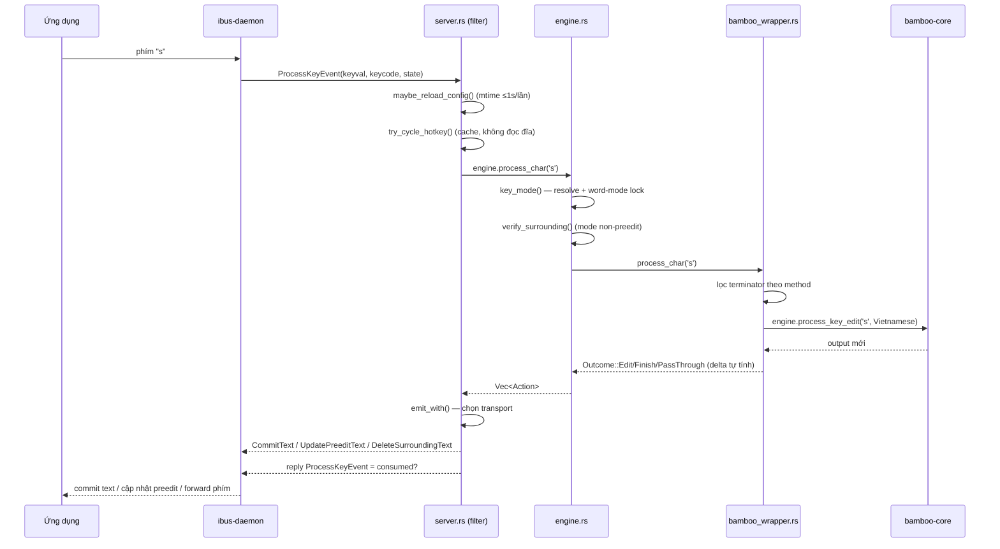

# 02 — Kiến trúc tầng bộ gõ (MăngRS)

> Chương này đi qua tiến trình engine, vòng đời từ lúc daemon spawn tới lúc xử lý từng
> phím, tám chế độ hiển thị, các transport xóa/ghi text, và cách cấu hình nóng. Kèm
> sequence diagram của một phím bấm.

## Tiến trình và vòng đời

`src/main.rs` là entry point: nạp config, tạo `Engine`, mở kết nối rồi chạy vòng lặp.
Không có thread xử lý phím riêng — **mọi phím đều xử lý trong message filter của D-Bus
connection** (single-threaded, thứ tự sự kiện được bảo toàn):

1. `Server::connect` (`src/server.rs`) — `Connection::open_private` tới private bus của
   ibus-daemon (khác session bus; bỏ qua handshake Hello nên phải `conn.register()`),
   claim tên `org.freedesktop.IBus.mangrs`, cài message filter.
2. ibus-daemon gọi `CreateEngine(s)` → engine trả về **object path** (`o`), không phải
   string (`src/server.rs::handle` — sai kiểu ở đây daemon im lặng không spawn engine).
3. Trước FocusIn, daemon đọc property `FocusId`/`ActiveSurroundingText` — phải trả
   **boolean** (`src/server.rs::handle`, nhánh `org.freedesktop.DBus.Properties`). Trả
   `true` cho `FocusId` mới nhận được `FocusInId(path, client)` — nguồn duy nhất biết
   *ứng dụng nào* đang gõ (prgname, ví dụ `gtk4-im:chrome`).
4. `FocusIn`/`Enable` → `engine.clear_buffer_state()` + nạp lại config + phát
   `RequireSurroundingText` (không có signal này GTK IM module không bao giờ gửi ST).
5. `FocusOut`/`Disable` → flush commit đang chờ echo, `reset()`, tắt enabled, quên
   client, dọn buffer state — giữ caps vì daemon không gửi lại khi refocus nhanh.

## Luồng một phím bấm



Điểm đáng chú ý trong flow:

- **Config hot-reload** nằm trong đường phím nhưng được gate theo mtime, tối đa một lần
  mỗi giây (`src/server.rs::maybe_reload_config`); cycle hotkey đọc từ cache parse sẵn
  (PERF-01 fix, `src/server.rs::refresh_hotkey_cache`).
- **`key_mode()`** (`src/engine.rs`) khóa chế độ của *cả từ* — daemon có flip capability
  giữa chừng, không được để mode lật dưới tay người dùng.
- **Backspace** đi đường riêng (`src/server.rs::process_key`, nhánh `keymap::BACKSPACE`):
  trước hết là echo của phím đã inject (phải forward nguyên vẹn — chính nó *là* cơ chế
  xóa), sau đó mới là backspace thật của người dùng.

## Máy trạng thái chính

```mermaid
stateDiagram-v2
    [*] --> Composing: chữ cái đầu từ (word_mode lock)
    Composing --> Composing: Outcome::Edit / PassThrough
    Composing --> Finished: terminator (space, Enter, dấu câu, số, _)
    Finished --> Composing: chữ cái tiếp theo
    Composing --> Parked: click (Reset + caret rời) — click_action keep
    Composing --> IdleCommitted: nghỉ 800ms (preedit_timeout_ms, bamboo mode)
    IdleCommitted --> Composing: phím dấu muộn (re-entry, is_late_mark_key)
    Composing --> NoComp: Backspace hết composition / focus out / reset
```

Chi tiết trạng thái chờ echo (`pending_injected`, `deferred`) và các deadline trong
`Engine::ms_until_tick` — vòng lặp chính (`Server::run`) ngủ đến deadline gần nhất thay
vì poll 1 giây cứng.

## Tám chế độ hiển thị

Định nghĩa trong `src/engine.rs::Mode`; chọn qua config/menu/hotkey/App Rules, hợp nhất
bởi `effective_mode()`:

| Mode | Cơ chế | Điều kiện rơi về Preedit |
|---|---|---|
| **Preedit** (mặc định) | composition inline, commit một lần cuối từ | client thiếu `IBUS_CAP_PREEDIT_TEXT` |
| **NonPreedit** | commit từng phím, sửa đuôi bằng xóa + commit lại | (không rơi; nhưng thiếu transport thì raw-forward) |
| **Surrounding** | NonPreedit + đối chiếu ST, sửa drift | — |
| **Smooth** | forward phím thô, cuối từ erase tail bằng Backspace thật | relay / không uinput |
| **Super Smooth** | Smooth không kiểm tra autofill | như trên |
| **Select** | Shift+Left chọn tail + Delete | relay / không uinput / không ST report |
| **OFF** | raw, macro vẫn chạy | — |
| **Default Typing** | inert hoàn toàn | — |

## Transports xóa/ghi text

`Action` (`src/engine.rs`) là ngôn ngữ trung gian; `server.rs::emit_with` dịch ra IBus
hoặc key injection:

| Transport | Khi nào dùng | Code |
|---|---|---|
| Protocol `DeleteSurroundingText(iu)` | client có ST report thật; repair-delete **cấm** trên relay | `emit_with` arm `DeleteBefore`/`DeleteSurrounding` |
| uinput Backspace (paced 5ms) | không có ST, hoặc client bị chứng minh nuốt delete | `src/uinput.rs::inject_backspaces` |
| `RewriteByBackspace` | repair khi client nuốt repair: nhấn k+extra Backspace rồi commit lại hậu tố chung | `src/engine.rs::verify_surrounding` |
| `InjectBackspaces` / `SelectLeft`+`PressDelete` | cuối từ trong Smooth/SuperSmooth/Select | `src/engine.rs::smooth_rewrite` |
| Clipboard (Ctrl+V) | `unicode_channel = "clipboard"` cho uinput modes, restore debounce 600ms | `src/paste.rs::paste_and_restore` |

Commit sau injection bị **defer** cho tới khi đủ echo được forward — commit đi D-Bus
nhanh hơn phím đi compositor, không defer thì echo Backspace xóa mất chữ vừa commit
("dấu nháy rồi lùi"). Echo mất/hết hạn 150ms được flush cả ở key handler lẫn main loop
(`Engine::ECHO_STALE`, `Engine::tick`).

## Quản lý trạng thái quanh từ

Trạng thái đậm nhất nằm ở `src/engine.rs` (trường struct `Engine`): `tail` (text tin là
đang nằm trước con trỏ), `surrounding` (report gần nhất), `repair_delete`,
`awaiting_delete_proof` (bằng chứng giao delete — TM-001), `pending_injected`/`deferred`,
`word_mode`, `url_word`, `suggestions`, `parked_word`/`reset_check` (bộ máy click giữa
chừng preedit, issue #14), `idle_committed`/`idle_raw` (re-entry dấu muộn). Muốn hiểu
một hành vi lạ: tìm tên trường tương ứng trong `docs/audit` hoặc đặt `debug_log = true`
và đọc `~/.cache/ibus-mangrs/debug.log` — log ghi quyết định, không ghi nội dung gõ.

## Đọc tiếp

- [03-kien-truc-core.md](03-kien-truc-core.md) — bên trong bamboo-core.
- [04-luong-xu-ly-chi-tiet.md](04-luong-xu-ly-chi-tiet.md) — bảng trạng thái từng bước cho các kịch bản gõ thật.
