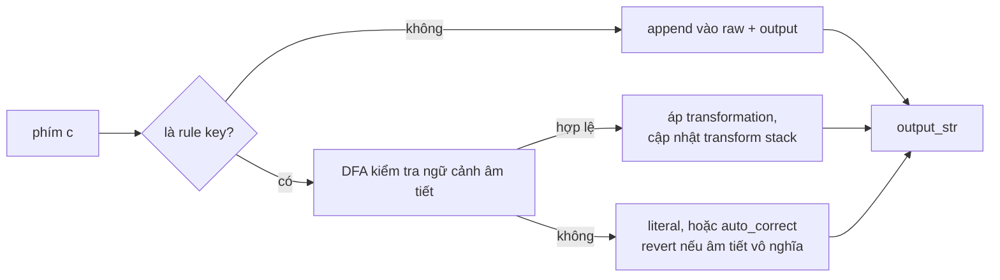

# 03 — Kiến trúc `bamboo-core`

> Chương này mổ xẻ crate lõi: module layout, mô hình transformation, thuật toán ghép dấu
> và hoàn tác, kiểm tra chính tả, bảng mã — những gì MăngRS dùng và những gì nó cố tình
> bỏ qua.

## Vị trí và nguồn

`bamboo-core = "0.5.3"` trong `Cargo.toml` — build dùng package từ crates.io. Submodule
`bamboo-core/` pin cùng tag `v0.5.3` (kiểm bằng `git submodule status`) chỉ để *đọc và
audit mã nguồn*. Mọi truy cập từ MăngRS đi qua `src/bamboo_wrapper.rs` — không file nào
khác import trực tiếp.

## Cấu trúc module

```
bamboo-core/src/
├── lib.rs                  API công khai + hướng dẫn chọn API (process_key vs process_key_edit)
├── config.rs               Config, ConfigBuilder, ToneStyle, W2uMode, BracketMode
├── mode.rs                 Mode::Vietnamese/English, OutputOptions
├── input_method/           preset Telex/VNI/VIQR/Microsoft... dạng dữ liệu phf_map (definitions.rs)
├── engine/                 state machine: mod, rules, state, snapshot, rebuild, restore
├── dfa/                    DFA cache chuyển tiếp âm tiết phổ biến (flattener.rs)
├── orthography/            kiểm tra CVC: syllable, phonetics, spelling, packing, tables
├── encoder/                encode_charset/decode_charset + tables.rs (bảng mã cũ)
├── ffi.rs / wasm.rs        bindings (không dùng bởi MăngRS)
└── parallel (feature)      batch processing (không dùng)
```

Nguồn: `bamboo-core/src/lib.rs` (crate doc ghi rõ mục tiêu: "< 1 µs / keystroke", gần
zero-allocation trên hot path) và `ls bamboo-core/src/`.

## Các API MăngRS dùng (và không dùng)

Đầy đủ ở `docs/bamboo-audit.md`; tóm lược những gì thực sự được gọi:

| API | Gọi ở | Vai trò |
|---|---|---|
| `Engine::with_config` / `InputMethod::{telex,vni,viqr,microsoft_layout}` | `src/bamboo_wrapper.rs::set_method` | dựng engine theo preset |
| `process_key_edit(c, Mode::Vietnamese)` | `src/bamboo_wrapper.rs::process_char` | xử lý một phím, engine giữ buffer nội bộ |
| `output_str()` | `src/bamboo_wrapper.rs::output` | composition hiện tại |
| `is_valid_word()` | `src/bamboo_wrapper.rs` (Finish, `is_valid`) | phonotactic check, quyết định auto-restore |
| `reset()`, `commit()` | nhiều nơi | xóa/hủy kết composition |
| `rebuild_from_text(text)` | `src/engine.rs::sync_from_surrounding` | nạp text app thật như thể vừa gõ |
| `encode_charset(charset, text)` | `src/bamboo_wrapper.rs::encode` | Unicode → bảng mã cũ |

**Cố tình không dùng**: `EditDelta` (delta so với `prev_preedit` nội bộ, không được
refresh sau backspace — dùng sẽ ăn chữ, lý do đầy đủ ở `src/bamboo_wrapper.rs::delta_from_last`),
`remove_last_output_char`/`undo_last_key` (để transform stack stale — wrapper tự cài
backspace kiểu unikey), `restore_last_word_as`, `get_processed_str`/`OutputOptions`,
`process`/`process_str` (debug), `warm_up` (deprecated).

## Mô hình "biến đổi"

Định nghĩa kiểu gõ là **dữ liệu**: `bamboo-core/src/input_method/definitions.rs` map
phím → rule, ví dụ preset VIQR:

```rust
static VIQR: InputMethodDef = phf_map! {
    "0" => "XoaDauThanh",
    "'" => "DauSac",
    "^" => "AEO_ÂÊÔ",
    "+" => "UO_ƯƠ",
    "(" => "A_Ă",
    "d" => "D_Đ",
};
```

Mỗi rule áp lên composition hiện tại khi DFA cho phép (nguyên âm đích tồn tại, âm tiết
còn hợp lệ). Thêm kiểu gõ mới = thêm entry dạng dữ liệu, không sửa logic — đó là lý do
MăngRS chọn preset thay vì tự cài quy tắc. Quy tắc dấu hình (`AEO_ÂÊÔ`...) ứng dụng dấu
lên vần; `add_tone_to_char` trong `orthography/phonetics.rs` quyết định ký tự mang dấu
thanh theo style (hiện đại/truyền thống).

Dòng xử lý một phím trong core (tóm lược từ `bamboo-core/src/engine/`):



`engine/snapshot.rs` giữ snapshot từng phím cho undo; `engine/state.rs` giữ raw keys +
transform stack — chính hai cấu trúc này gây "poison state" khi hoàn tác dấu mà không
replay, lý do MăngRS chọn replay-thay-vì-undo (ADR trong chương 11).

## Cấu trúc dữ liệu chính

```mermaid
classDiagram
    class Engine_Core["Engine (bamboo-core)"]
    Engine_Core : +InputMethod rules/keys
    Engine_Core : +Config config
    Engine_Core : +process_key_edit(c, Mode) EditDelta
    Engine_Core : +output_str() String
    Engine_Core : +is_valid_word() bool
    Engine_Core : +reset() / commit()
    Engine_Core : +rebuild_from_text(text)

    class InputMethod {
        +name
        +rules: phf_map key→rule
    }
    class Config {
        +ToneStyle tone_style
        +free_tone_marking
        +auto_correct
        +W2uMode w2u_mode
        +BracketMode bracket_mode
    }

    class Outcome["Outcome (wrapper)"] {
        Edit(Edit)
        PassThrough
        Finish{word, raw, valid}
    }
    class Edit {
        +delete_chars: usize
        +insert: String
    }

    Engine_Core *-- InputMethod : preset dạng dữ liệu
    Engine_Core *-- Config
    Outcome *-- Edit
```

Sơ đồ trên là các cấu trúc mà MăngRS thực sự chạm tới: `Engine` giữ `InputMethod`
(định nghĩa kiểu gõ dạng dữ liệu) và `Config`; wrapper gói kết quả mỗi phím thành
`Outcome` với `Edit` — delta tự tính theo `last_output`, không phải `EditDelta` của core
(ADR-01, chương 11).

## Kiểm tra chính tả (orthography)

`bamboo-core/src/orthography/` kiểm tra cấu trúc CVC của âm tiết (`is_valid_word`,
`is_valid_prefix`). Đây là cơ chế **auto-correct/revert**: gõ `window` theo Telex,
`wi` không hợp lệ → composition reverted về raw keys. Lưu ý phân biệt: đây là kiểm tra
*phonotactic*, khác hẳn danh sách từ — danh sách 38 350 từ trong `data/vn-words.txt`
chỉ là lookup advisory, không tham gia quyết định commit
(`src/spellcheck.rs`, `src/engine.rs::known_word` — hiện chưa có consumer, ghi rõ ở
`docs/gap-analysis.md`).

## Bảng mã

`encoder/tables.rs` chứa 17 biến thể charset; MăngRS expose 11 qua
`src/bamboo_wrapper.rs::Charset`. Đặc tính then chốt: bảng cũ có thể **đổi số ký tự**
(VNI `â` → `aâ`) — mọi logic đếm trong MăngRS đếm *sau khi encode*
(`src/engine.rs::on_edit` nhánh legacy gọi `rewrite()` viết lại cả từ).

## Hiệu năng

Doc crate tuyên bố sub-µs/phím nhờ DFA cache branchless; MăngRS không đo lại con số này
(ghi chú trung thực), phần chi phí của riêng MăngRS nằm ở D-Bus + clone buffer ST, đã
được giảm trong đợt audit (clone một lần trong `src/engine.rs::set_surrounding`, nạp
file theo mtime trong `apply_config`).

## Đọc tiếp

- [04-luong-xu-ly-chi-tiet.md](04-luong-xu-ly-chi-tiet.md) — core và wrapper phối hợp thế nào trong từng kịch bản.
- [11-quyet-dinh-thiet-ke.md](11-quyet-dinh-thiet-ke.md) — vì sao bỏ EditDelta, vì sao replay thay vì undo.
