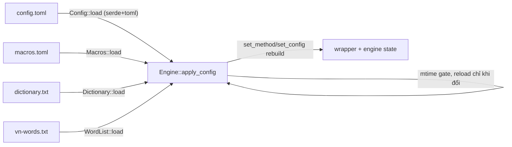

# 08 — Dữ liệu và cấu hình

> Chương này mô tả mọi file dữ liệu mà engine đọc/ghi: schema, mặc định, đường nạp trong
> code. Không phải hướng dẫn thao tác — xem `docs/guide/04-cau-hinh.md` nếu muốn chỉnh
> theo kiểu "làm thế nào".

## `~/.config/ibus-mangrs/config.toml`

Schema = struct `Config` trong `src/config.rs` (serde, `#[serde(default)]` — thiếu key
lấy mặc định, TOML lỗi thì fallback `Config::default()` an toàn, `Config::load`).
Nhóm chính:

| Nhóm | Key (mặc định) | Code |
|---|---|---|
| Bật/tắt | `enabled` (true) | `src/engine.rs::set_enabled` |
| Kiểu gõ | `method` = telex \| vni \| viqr \| microsoft | `src/config.rs::MethodConfig` → `Method::to_bamboo` |
| Chế độ | `mode` = preedit \| nonpreedit \| surrounding \| smooth \| supersmooth \| select \| off \| defaulttyping | `ModeConfig` → `src/engine.rs::Mode` |
| Bảng mã | `charset` (unicode; +10 bảng cũ) | `CharsetConfig` → `src/bamboo_wrapper.rs::Charset` |
| Dấu | `modern_tone_style` (true), `free_tone_marking` (true), `auto_correct` (true) | `bamboo_config()` → bamboo `ToneStyle`/flags |
| Hành vi | `auto_restore` (true), `bypass_url` (true), `w2u` (disabled), `bracket` (disabled), `em_dash` (false), `auto_capitalize` (false), `double_space_period` (false) | `src/engine.rs` các trường mirror |
| Macro/từ điển | `macro_enabled` (true), `capitalize_macro` (true), `macro_in_off_mode` (false), `time_format` (%H:%M), `date_format` (%d/%m/%Y), `dictionary_enabled` (false), `abbreviations` (true) | `src/macros.rs`, `src/bamboo_wrapper.rs::set_abbreviations` |
| Click #14 | `click_action` (bamboo\|keep\|relocate), `preedit_commit_timeout_ms` (800, 0=tắt) | `src/engine.rs::on_client_reset`/`tick` |
| uinput | `backspace_interval_ms` (5), `post_delay_ms` (10), `unicode_channel` (commit\|clipboard) | `src/uinput.rs`, `src/paste.rs` |
| Khác | `cycle_mode_hotkey` (rỗng), `hide_underline` (false), `debug_log` (false), `app_rules` (built-in chrome-family/sublime) | `src/server.rs::parse_hotkey`, `emit_with`, `client_rule_mode` |

Hai chi tiết đáng chú ý:

- **`commit_interval_ms` (20) là dead config** — có GUI edit, có getter
  (`src/engine.rs::commit_interval_ms`) nhưng không consumer (`docs/gap-analysis.md`
  Known gap #1; chờ chủ dự án wire-in hoặc xoá).
- **Ghi không phá key lạ**: `Config::save` merge lên file cũ
  (`src/config.rs::merge`) — key của phiên bản khác không bị mất.
- **Migrate**: config `unikey`/`r-unikey` cũ được copy sang thư mục mới một lần
  (`src/config.rs::migrate_old_config`).

## `~/.config/ibus-mangrs/macros.toml`

`BTreeMap<String, String>` mỗi dòng `key = "expansion"`, parse bằng `toml`
(`src/macros.rs::Macros::load`); `$TIME`/`$DATE` thay bằng `chrono` theo format trong
config. Ghi qua `Macros::save` (GUI).

## `~/.config/ibus-mangrs/dictionary.txt`

Một từ mỗi dòng, `#` comment, lowercase khi so (`src/macros.rs::Dictionary::load`).
Ý nghĩa duy nhất: chặn auto-restore cho từ trong đó.

## `vn-words.txt` (dữ liệu spell check)

38 350 từ UTF-8 NFC. Thứ tự nạp (`src/spellcheck.rs::candidates`):
1. `~/.config/ibus-mangrs/vn-words.txt` (override người dùng),
2. `/usr/share/ibus-mangrs/vn-words.txt` (do `scripts/install.sh`/PKGBUILD cài),
3. `data/vn-words.txt` trong repo (dev/test).
Nguồn + license GPL của danh sách: `data/README.md`. ⚠️ Lookup-only — chưa có consumer
(`docs/gap-analysis.md`).

## `data/ibus-mangrs.xml` — component XML

Đăng ký engine với ibus-daemon: tên `MăngRS`, bus `org.freedesktop.IBus.mangrs`, engine
`ibus-mangrs`, path `/usr/lib/ibus-mangrs/ibus-engine-ibus-mangrs`. **Bắt buộc khớp**
hằng số trong `src/server.rs` (`BUS_NAME`, `ENGINE_PATH`) — lệch một ký tự daemon
im lặng không spawn engine. Daemon chỉ scan `/usr/share/ibus/component` (và
`IBUS_COMPONENT_PATH` khi dev — `ARCHITECTURE.md` Testing).

## `data/80-uinput.rules`

`KERNEL=="uinput", MODE="0660", GROUP="input"` — cài vào `/usr/lib/udev/rules.d/` bởi
PKGBUILD (`PKGBUILD::package`) hoặc `/etc/udev/rules.d/` bởi script. Thiếu rule →
transport Backspace không mở được → engine rơi về raw-forward/protocol (không crash).

## Luồng nạp lúc runtime

Mỗi file có mtime riêng (`src/engine.rs::apply_config` — `file_time`) nên sửa
macros.toml không cần đổi config.toml vẫn ăn ở lần focus kế.

## Đọc tiếp

- [05-tinh-nang.md](05-tinh-nang.md) — ý nghĩa từng nhóm tùy chọn.
- [11-quyet-dinh-thiet-ke.md](11-quyet-dinh-thiet-ke.md) — vì sao `commit_interval_ms` còn treo.
